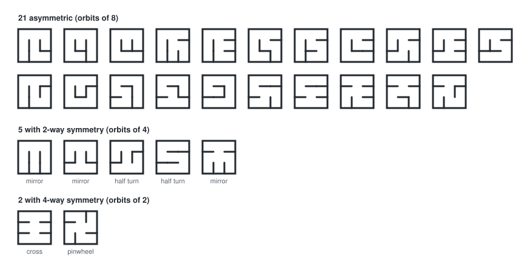
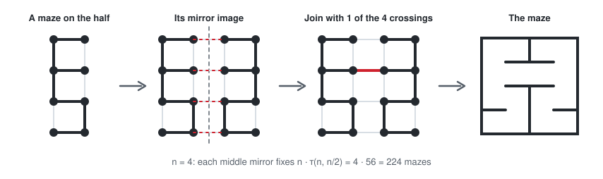
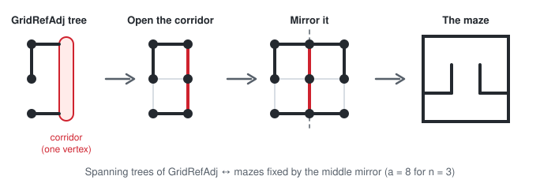
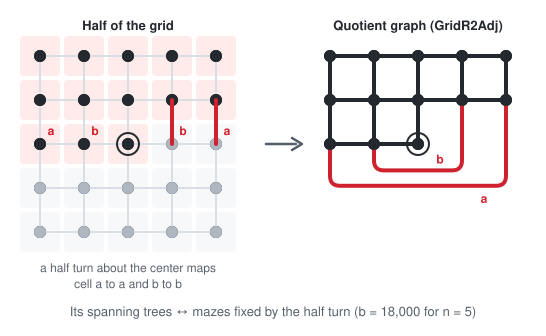
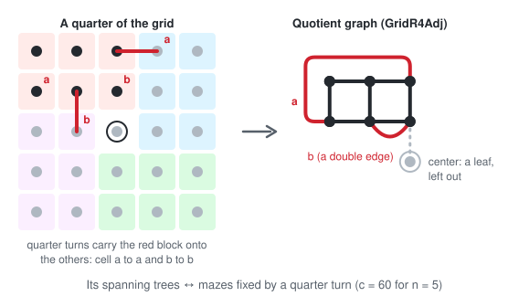

# Calculating Maze Counts

This page explains how the maze counts in the [README](README.md) are
calculated:

1. [Counting by enumeration](#counting-by-enumeration): how this repo
   generates every maze and counts the unique ones.
2. [Counting with algebra](#counting-with-algebra): Kirchhoff's matrix-tree
   theorem and Burnside's lemma give the number of unique mazes
   ([A349718](https://oeis.org/A349718)) without generating any.
3. [The PARI program on the OEIS](#the-pari-program-on-the-oeis): Andrew
   Howroyd's implementation of that method, explained line by line.
4. [Symmetric mazes](#symmetric-mazes): the same ideas extended to count the
   *symmetric* mazes, with an exact closed form.
5. [Is there a recurrence?](#is-there-a-recurrence)

Throughout, a *maze* on an $n \times n$ grid of cells is a set of open
passages such that there is exactly one path between any two cells.  In graph
terms it is a *spanning tree* of the grid graph, whose vertices are the cells
and whose edges are the $2n(n-1)$ possible passages.

# Counting by enumeration

The code in [src/maze-generator.ts](src/maze-generator.ts) visits every maze
of a given size; it is how this repo counts mazes up to $5 \times 5$.

**Walls.**  A maze is stored as an array of the internal walls in row-major
order: the vertical walls of row 0, then the horizontal walls under row 0,
then the vertical walls of row 1, and so on ($2n(n-1)$ walls in all).

**Row-by-row generation.**  `allMazesFromRow()` fills in the walls one row at
a time: every combination of the vertical walls within a row, then every
combination of the floor walls beneath it.  Two checks cut the search short:

- `allHaveExit()` is applied after each row's floor is chosen.  Every cell
  placed so far must still be able to reach an opening into the next row;
  otherwise some region is sealed off and can never join the rest of the maze,
  so that whole branch of the search is skipped.
- `uniquelyConnected()` is applied when the last row is complete.  A walk from
  the first cell must reach every cell without ever arriving at a cell twice
  (which would mean a loop).

**Symmetry.**  The square has 8 symmetries: 4 rotations and 4 reflections.
Each one permutes the wall positions, so `calcTransforms()` precomputes the 7
non-trivial ones as permutations of wall indices (a non-square grid has only
3).  `calcSym()` then compares a maze with each of its 7 images:

- Its *symmetry* is the number of the 8 symmetries that map it to itself (the
  order of its *stabilizer*): 1 for an asymmetric maze, 2 or 4 for a symmetric
  one.
- It is *canonical* if its wall array is the lexicographically smallest of
  all its images: reading walls in index order, at the first position where
  it differs from an image it has an opening and the image has a wall.

Each set of mazes related by symmetry (an *orbit*) has exactly one canonical
member, so the number of unique mazes is the number of canonical mazes.  An
orbit holds $8 / s$ mazes when its symmetry is $s$, which is how
`countMazes()` splits the total by symmetry:

```
There are 557,568,000 mazes of size 5x5.
69,699,849 are unique:
---
69,692,175 are not symmetric.     (orbits of 8)
7,626 have 2-way symmetry.        (orbits of 4)
48 have 4-way symmetry.           (orbits of 2)
```

For $3 \times 3$ these are the 28 unique mazes (the example in the A349718
entry), each shown by its canonical member:



Since every maze is visited, the time grows with the number of mazes: about
2 seconds for the 100,352 mazes of size $4 \times 4$, and hours for the
557,568,000 of size $5 \times 5$.  The $6 \times 6$ grid has over $3 \times
10^{13}$ mazes, out of reach of enumeration.

# Counting with algebra

## Counting all mazes: Kirchhoff's theorem

[Kirchhoff's matrix-tree theorem](https://en.wikipedia.org/wiki/Kirchhoff%27s_theorem)
counts the spanning trees of any graph with a determinant.  The *Laplacian*
of a graph is the matrix $L = D - A$, where $A$ is the adjacency matrix and $D$
the diagonal matrix of vertex degrees.  Delete any one row and the matching
column of $L$; the determinant of what remains is the number of spanning
trees.

For grid graphs the determinant can be written out in closed form.  The
Laplacian of a $p \times q$ grid is built from those of two paths, so its
eigenvalues are the sums of path eigenvalues, and the number of spanning
trees (the product of the non-zero eigenvalues divided by the number of
vertices) is

$$
\tau(p, q) = \frac{1}{pq} \prod_{\substack{0 \le j < p,\ 0 \le k < q \\ (j,k) \ne (0,0)}}
\left( 4 \sin^2 \frac{j \pi}{2p} + 4 \sin^2 \frac{k \pi}{2q} \right)
$$

This is [A007341](https://oeis.org/A007341) for $p = q = n$ (and
[A116469](https://oeis.org/A116469) in general).

## Counting unique mazes: Burnside's lemma

[Burnside's lemma](https://en.wikipedia.org/wiki/Burnside%27s_lemma) counts
orbits by averaging fixed points: the number of unique mazes is the average,
over the 8 symmetries $g$ of the square, of the number of mazes that $g$ maps to
itself,

$$
\text{unique}(n) = \frac{1}{8} \sum_{g} \text{Fix}(g)
$$

(An orbit of $8/s$ mazes, each fixed by $s$ symmetries, contributes exactly
$8$ to the sum.)  The identity fixes all A007341(n) mazes.  The other terms are
small corrections, each a spanning tree count of a smaller graph:

- **Diagonal reflections** fix no maze (for $n > 1$).
- **Even $n$**: rotations fix no maze.  Each of the two middle reflections
  fixes $n \cdot \tau(n, n/2)$ mazes: a maze of one half, its mirror image,
  and one of the $n$ passages across the middle.
- **Odd $n$**: each middle reflection fixes $a$ mazes, the half turn $b$, and
  each quarter turn $c$.

The reasons, and formulas for $a$, $b$ and $c$, are given
[below](#which-symmetries-can-fix-a-maze).  Altogether

$$
\text{unique}(n) =
\begin{cases}
\dfrac{\tau(n, n) + 2n\,\tau(n, n/2)}{8} & n \text{ even} \\[2ex]
\dfrac{\tau(n, n) + 2a + b + 2c}{8} & n \text{ odd}
\end{cases}
$$

For $n = 3$: $(192 + 2 \cdot 8 + 12 + 2 \cdot 2) / 8 = 28$.

# The PARI program on the OEIS

The A349718 entry links a
[PARI/GP program](https://oeis.org/A349718/a349718.txt) by Andrew Howroyd
(2021) that computes the sequence this way, to $n = 40$.  Here is how it
works, quoting its code.  The diagrams redraw the ASCII sketches in its
comments; they are generated, and their graphs checked, by
[analysis/draw_diagrams.py](analysis/draw_diagrams.py).

**Spanning trees from an adjacency matrix.**  This is Kirchhoff's theorem
directly: `vecsum(Vec(M))` sums the columns of the adjacency matrix $M$ to
get the degrees, and the determinant is taken after deleting row and column 1.

```
LaplacianMatrix(M)={matdiagonal(vecsum(Vec(M))) - M}
SpanningTreeCount(M)={my(n=#M); abs(matdet(LaplacianMatrix(M)[2..n, 2..n]))}
```

**The grid.**  Cell $i$ (counting from 0) of an $n \times m$ grid is at column
`i%m` and row `i\m`, and two cells are adjacent when they are one step apart.

```
GridAdj(n,m)={matrix(n*m, n*m, i, j, i--; j--; my(ix=i%m, iy=i\m, jx=j%m, jy=j\m); abs(ix-jx) + abs(iy-jy) == 1)};
A007341(n)=SpanningTreeCount(GridAdj(n,n))
```

**A faster A007341.**  The program replaces that determinant with a resultant
of two Chebyshev polynomials:

```
A007341(n)={polresultant( polchebyshev(n-1, 2, x/2), polchebyshev(n-1, 2, (4-x)/2) )};
```

`polchebyshev(n-1, 2, t)` is the Chebyshev polynomial $U_{n-1}(t)$, whose
roots are $\cos(k\pi/n)$ for $k = 1, \ldots, n-1$.  So the first polynomial
has roots $2\cos(k\pi/n) = 2 - \lambda_k$ and the second
$4 - 2\cos(k\pi/n) = 2 + \lambda_k$, where $\lambda_k = 4\sin^2(k\pi/2n)$
are the non-zero eigenvalues of a path of $n$ cells.  The resultant of two
polynomials is (up to leading coefficients, here $\pm 1$) the product of the
differences of their roots, so its absolute value is

$$
\prod_{j=1}^{n-1} \prod_{k=1}^{n-1} (\lambda_j + \lambda_k)
$$

the terms of the product formula for $\tau(n,n)$ with $j, k \ge 1$.  The remaining terms (where $j = 0$ or $k = 0$) are
$\prod_k \lambda_k^2 = n^2$, which cancels the $1/n^2$.  The resultant is
computed exactly with integer polynomial arithmetic, so no determinant or
trigonometry is needed.

**Even $n$: middle reflections.**  These fix $n \cdot \tau(n, n/2)$ mazes
each, so the program uses `n*SpanningTreeCount(GridAdj(n,n/2))` per
reflection.  For $n = 4$: a maze on the $4 \times 2$ half, mirrored, and joined
by one of the 4 passages that cross the mirror line.



**Odd $n$: middle reflections.**  A maze fixed by the reflection through the
middle column must include every passage along that column (the
[count of passages](#which-symmetries-can-fix-a-maze) leaves no other
choice), so the middle column is a straight corridor.  Such a maze is determined by its half
beside the corridor, which must be a spanning tree of that half once the
whole corridor is shrunk to a single vertex.  `GridRefAdj` builds that graph:
$\lfloor n/2 \rfloor$ rows of $n$ cells (the half, turned on its side) plus
one extra vertex joined to every cell of the last row (the corridor).

```
GridRefAdj(m,n) = {
   my(t=n*m+1); matrix(t,t,i,j, i--;j--; my(ix=i%m, iy=i\m, jx=j%m, jy=j\m);
      (abs(ix-jx) + abs(iy-jy) == 1) || (iy+jy==2*n-1))
}
```

The extra vertex has index $nm$, so its row is $n$, and `iy+jy==2*n-1` joins it
to row $n - 1$.  For $n = 3$, a spanning tree of `GridRefAdj` becomes a maze by
opening the corridor and mirroring:



**Odd $n$: half turn.**  The center cell is the only cell or passage a
half turn maps to itself, so a maze it fixes is made of pairs of passages
(each passage with its rotated copy), and is determined by the passages on one half.  Those form a
spanning tree of the *quotient graph*, which has one vertex for each pair of
cells $\lbrace x, \text{rotated } x \rbrace$ and one edge for each pair of passages.
Conversely, every spanning tree of the quotient graph unfolds into a maze,
since the center is fixed.  `GridR2Adj(n)` (called with $\lfloor n/2 \rfloor$)
builds the quotient from the top half of the grid: $\lfloor n/2 \rfloor$
full rows, plus the middle row's cells up to and including the center.  The
passages leading down into the missing right half of the middle row are joined
instead to its rotated copy, the left half (`ix+jx==m-1`).  For $n = 5$ those
are the two red passages, $a$ and $b$:



```
GridR2Adj(n) = {
   my(m=2*n+1, t=n*m + m\2 + 1); matrix(t,t,i,j, i--;j--; my(ix=i%m, iy=i\m, jx=j%m, jy=j\m);
       (abs(ix-jx) + abs(iy-jy) == 1) || (ix+jx==m-1 && iy+jy==2*n-1))
}
```

**Odd $n$: quarter turns.**  The same idea with orbits of 4 cells.  The
quotient is a $\lfloor n/2 \rfloor \times \lceil n/2 \rceil$ block (one
quarter of the grid, without the center) with extra edges gluing its first
column to its first row, where a quarter turn carries one onto the other.
The center cell is left out: its four neighbours form a single orbit, so in
the quotient it would be a leaf, which doesn't change the number of spanning
trees.  At the corner of the block beside the center, two different orbits of passages join the same
two orbits of cells, so the quotient has a double edge, which is why the adjacency matrix *adds* its
terms (`+`) instead of using `||`.  For $n = 5$ (drawn as 2 rows of 3; the
program lays the same block out as 3 rows of 2):



```
GridR4Adj(n) = {
  my(m=n, t=n*(n+1)); matrix(t,t,i,j, i--;j--; my(ix=i%m, iy=i\m, jx=j%m, jy=j\m);
      (abs(ix-jx) + abs(iy-jy) == 1) + (ix==0&&jy==0&&iy==jx+1) + (jx==0&&iy==0&&jy==ix+1))
}
```

**Burnside's lemma.**  Finally the fixed counts are averaged over the 8
symmetries, with 2 middle reflections and 2 quarter turns:

```
a(n)={if(n==1, 1, (A007341(n) + if(n%2==0,
    2*n*SpanningTreeCount(GridAdj(n,n/2)), \\ even n, horizontal or vertical reflection
      2*SpanningTreeCount(GridRefAdj(n,n\2)) \\ odd n, horizontal or vertical reflection
      + SpanningTreeCount(GridR2Adj(n\2))    \\ odd n, half turn rotation
      + 2*SpanningTreeCount(GridR4Adj(n\2))) \\ odd n, quarter turn rotation
    )/8)}
```

[analysis/symmetric_mazes.py](analysis/symmetric_mazes.py) builds the same
graphs in Python (as contracted and quotient graphs), and its fixed counts
agree with the PARI graphs for $n = 3, 5, 7, 9$; for $n = 5$ they are $a = 6336$,
$b = 18000$ and $c = 60$.

# Symmetric mazes

How many mazes are *symmetric*, mapped to themselves by some rotation or
reflection?  As for A349718, related mazes are counted once.

Burnside's lemma only gives the total number of orbits.  Separating the
symmetric orbits by their stabilizer needs one more fixed count, and the
fixed counts themselves have closed forms like the one for $\tau(p,q)$.  The
results are in the README; the code is
[analysis/symmetric_mazes.py](analysis/symmetric_mazes.py) (Python standard
library only):

```
$ python3 analysis/symmetric_mazes.py 12      # counts for n = 1..12
$ python3 analysis/symmetric_mazes.py --recurrences
```

It computes each count twice, as exact determinants and from the product
formulas below, and checks them against the exhaustive counts for
$n \le 5$ and, through Burnside's lemma, against every term of A349718 for
$2 \le n \le 11$: the unique mazes are the asymmetric orbits (8 mazes each)
plus the symmetric ones (4 mazes per 2-way orbit, 2 per 4-way orbit).  CI runs
it on every push.

## Which symmetries can fix a maze

A maze is a spanning tree of the grid of cells.  Every tree has a *center*: a
single cell, or a single passage between two cells (the middle of its longest
paths).  Any symmetry of the tree maps its center to itself, which rules out
most of the eight symmetries of the square.

**Diagonal reflections never fix a maze** (for $n > 1$).  No passage joins a
cell to its own mirror image across a diagonal, so the passages of a symmetric
maze come in mirror pairs.  Its half on one side of the diagonal (including the
diagonal cells) must be connected, so it is a spanning tree of that half; the
two halves together then have too many passages to be a tree.

**Even $n$.**  A rotation of an even grid fixes no cell and no passage, so no
maze is rotationally symmetric, and there are no 4-way symmetric mazes.  The
reflection between the two middle columns fixes only the $n$ passages that
cross it.  A maze it fixes has its center on one of those passages: it is a
maze of the $n \times \frac{n}{2}$ half, its mirror image, and exactly one
crossing passage.  (Two crossings would make a loop, since each joins a cell to
its own image.)  The two middle reflections are related by rotation, so each
orbit holds 4 such mazes, and

$$
S(n) = \frac{2 \cdot n \cdot \tau(n, n/2)}{4} = \frac{n}{2}\, \tau\!\left(n, \frac{n}{2}\right)
$$

**Odd $n = 2m + 1$.**  Every symmetry fixes the center cell, and four kinds
of symmetry can fix a maze.  Write

$$
\lambda_j = 4 \sin^2 \frac{j \pi}{2n}, \qquad \mu_k = 4 \sin^2 \frac{(2k - 1) \pi}{2n}
$$

for the eigenvalues of a path of $n$ cells with free ends ($\lambda$) and of
a path of $m$ cells whose last cell is joined to a fixed one ($\mu$).

- **Middle reflection** ($a$ mazes each for the vertical and horizontal
  reflections).  The passages along the axis are their own mirror images.
  Counting passages shows that a fixed maze contains *all* of them: its middle
  column is one straight corridor, and its closed half is a spanning tree
  containing that corridor.  Contracting the corridor to a single cell (the
  graph `GridRefAdj` above),

  $$
  a = \prod_{j=0}^{n-1} \prod_{k=1}^{m} (\lambda_j + \mu_k)
  $$

- **Both middle reflections** ($d$ mazes).  Both middle corridors are open (a
  cross), and the maze is a spanning tree of one closed quadrant containing
  its two half-corridors:

  $$
  d = \prod_{j=1}^{m} \prod_{k=1}^{m} (\mu_j + \mu_k)
  $$

- **Rotation by 180° and 90°** ($b$ and $c$ mazes).  A fixed maze is a
  spanning tree of the quotient graph (`GridR2Adj` and `GridR4Adj` above).
  The Laplacian on rotation-invariant patterns has eigenvalues
  $\lambda_j + \lambda_k$ over the products of path eigenvectors that the
  rotation fixes, and the matrix-tree theorem for the weighted quotient gives

  $$
  b = \frac{1}{n^2} \prod_{\substack{j + k \text{ even} \\ (j,k) \ne (0,0)}} (\lambda_j + \lambda_k)
  $$

  $$
  c = \frac{1}{n^2} \prod_{\substack{j < k \\ j + k \text{ even}}} (\lambda_j + \lambda_k)
  \prod_{\substack{j \text{ even} \\ j > 0}} 2 \lambda_j
  $$

  with $j, k$ running from $0$ to $n - 1$.

A maze's stabilizer is then one of $\langle r \rangle$ (90° rotation, $c$
mazes), both middle reflections, $\lbrace e, r^2, V, H \rbrace$ ($d$),
$\langle r^2 \rangle$ alone ($b - c - d$), or a single middle reflection
($a - d$ each).  No maze larger than $1 \times 1$ has a larger stabilizer,
since every larger subgroup contains a diagonal reflection.  Dividing each
count by its orbit size (8 over the stabilizer's order),

$$
S(n) = \frac{2a + b + c - d}{4}, \qquad
\text{4-way} = \frac{c + d}{2}, \qquad
\text{2-way} = S(n) - \frac{c + d}{2}
$$

For $n = 3$: $a = 8$, $b = 12$, $c = 2$, $d = 2$, so $S(3) = 7$, of which 2
are 4-way: one pinwheel ($c$) and one cross ($d$).

# Is there a recurrence?

For a grid of fixed width the counts satisfy a linear recurrence with constant
coefficients (so they have a rational generating function).  Building the maze
one column at a time, as the generator does row by row, only the connectivity
of the current column matters, and there are finitely many such states.

| Grid | Mazes | Recurrence |
|---|---|---|
| $2 \times n$ | 1, 4, 15, 56, 209, ... | $a_n = 4 a_{n-1} - a_{n-2}$ |
| $3 \times n$ | 1, 15, 192, 2415, 30305, ... | $a_n = 15 a_{n-1} - 32 a_{n-2} + 15 a_{n-3} - a_{n-4}$ |
| $4 \times n$ | 1, 56, 2415, 100352, ... | order 7: 56, −672, 2632, −4094, 2632, −672, 56, −1 |

For $n \times n$ mazes there is none: A007341 grows like
$e^{4Gn^2/\pi}$ ($G$ is Catalan's constant), and a sequence satisfying any
linear recurrence, even with polynomial coefficients, grows at most like
$(n!)^r C^n$.  So A007341, A349718 and the symmetric counts have no such
recurrence, and their generating functions are not rational, algebraic or
D-finite.  The products above are as closed as the answer gets.

<script defer>
MathJax = {
  tex: {
    inlineMath: [['$', '$'], ['\\(', '\\)']]
  }
};
</script>

<script id="MathJax-script" defer
  src="https://cdn.jsdelivr.net/npm/mathjax@3/es5/tex-chtml.js">
</script>
